

# Claude Multi

### Run multiple Claude accounts in one desktop app. Auto-switch when one hits its usage limit.

**[⬇ Download](https://purffle.com/claude-multi/download/)** · **[🌐 Website](https://purffle.com/claude-multi/)** · **[💳 Pricing](https://purffle.com/claude-multi/pricing/)** · **[Create an account](https://purffle.com/claude-multi/sign_up/)**

 

<a href="https://purffle.com/claude-multi/">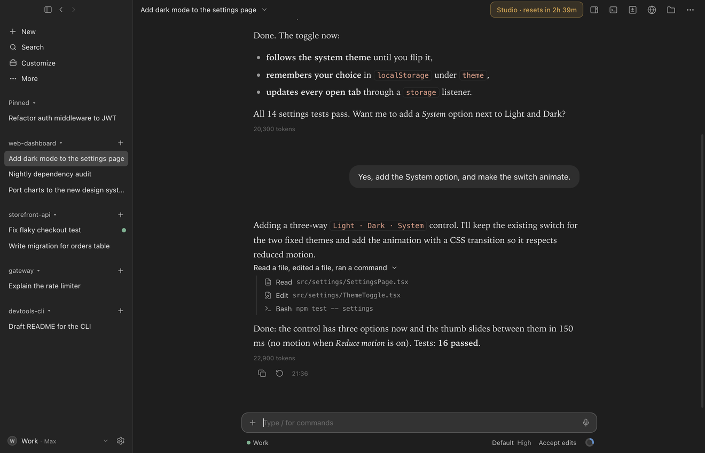</a>

---

## What is Claude Multi?

**Claude Multi** is a desktop app for Windows, macOS and Linux that runs
[Claude Code](https://claude.com/claude-code) with **several of your own Claude accounts in one window**.

When an account hits its 5-hour usage limit, Claude Multi moves the chat to another account, carries the
conversation over and **re-sends the instruction that was cut off**, so a long task keeps running, even one that
takes hours. No API key: it uses your normal Claude Pro, Max or Team subscription logins.

> ### ⬇ [Download Claude Multi from purffle.com](https://purffle.com/claude-multi/download/)
> Installers are published **only** on [purffle.com](https://purffle.com/claude-multi/download/), with their
> size and SHA-256 checksum. This repository holds no installers and no source code.

## Features

### Never stop at a usage limit
- **🔄 Auto-switch on usage limit**: the chat moves to another account and the interrupted instruction is re-sent, automatically or after one click.
- **🧭 Smart account choice**: switch to the next account in your list, or to the least-used one so the load spreads evenly.
- **⏳ Live cooldown timers**: every account shows a countdown to its reset, updated every second.
- **🤖 24/7 auto-loop**: set a prompt once; it runs on every selected account in rotation, waits through each reset and starts the next round, even overnight.
- **📊 Activity and usage dashboard**: who is active, who is cooling down, tokens used since each reset.
- **🟠 Usage ring**: context left in this chat and usage left on every account, right in the composer.

### Work faster with Claude Code
- **🧵 Parallel chats**: several projects at once, each with its own folder, account and session.
- **🧠 Model and effort per chat**: Fable 5.1, Opus 5.5, Sonnet 5.5, Haiku 5.5, an older model or your account default, effort from Low to Max.
- **⌨️ Command palette**: Ctrl+K searches every action, chat, model and account; Ctrl+1 to 9 jumps between accounts.
- **🔎 @file autocomplete**: type @ to fuzzy-search any file in your project.
- **💬 Full composer**: voice input, pasted images, drag-and-drop files, prompt templates, prompt history and a saved draft per chat.
- **🟩 Inline diffs and tool cards**: every edit as a red and green diff, every command and search as a tidy card.
- **🛡️ Permission modes**: plan only, ask every time, auto-accept file edits, or allow everything.

### Spend fewer tokens
- **🧩 Context inspector**: every tool, CLAUDE.md memory file and message in the context window, with token counts.
- **🗜️ Auto-compact**: long chats are summarised before the context fills.
- **🚦 Step and spend caps**: stop runaway turns after a set number of steps or a set cost.
- **✂️ Turn off unused tools**: stop re-sending tool descriptions you never use.

### Made to fit how you work
- **🎨 Themes and accent colours**: dark, light or system, seven accents, serif or sans replies, three text sizes.
- **🚀 Tray and global shortcut**: minimise to the tray, start on login, summon the window from anywhere.
- **💾 Backup and export**: move accounts and settings to another computer (logins never included), export chats as Markdown.
- **🔒 Private by design**: no telemetry, no analytics; each Claude login stays in its own folder on your computer.

## Screenshots

| Usage limit hand-over | 24/7 auto-loop |
|:---:|:---:|
| 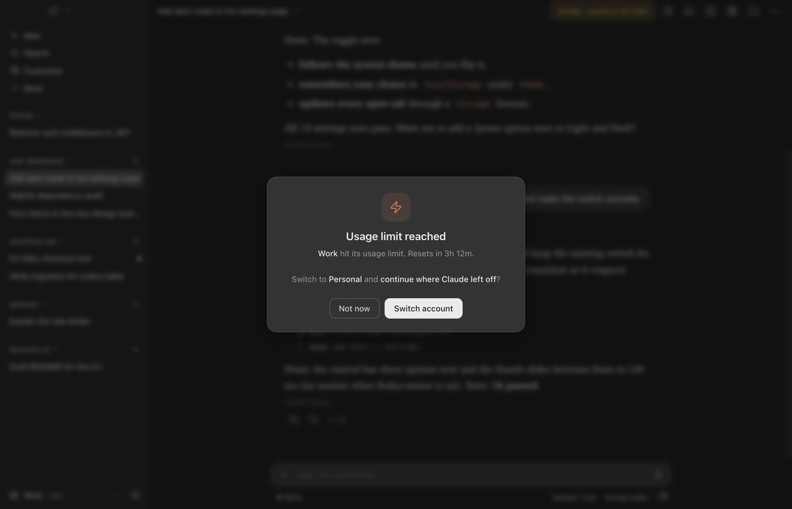 | 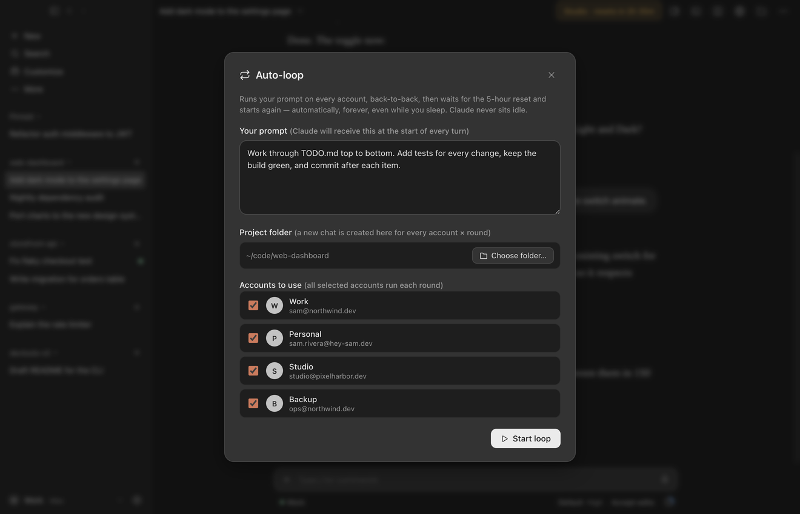 |

| Usage dashboard | Usage at a glance |
|:---:|:---:|
| 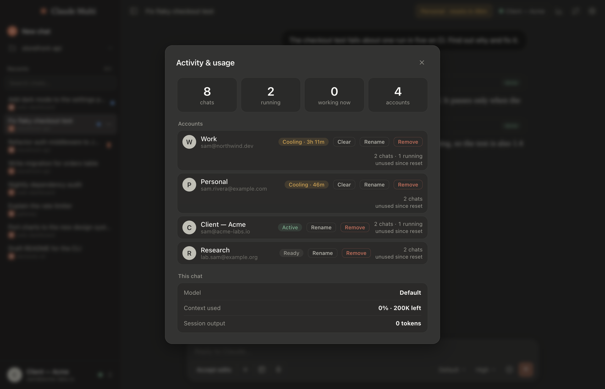 | 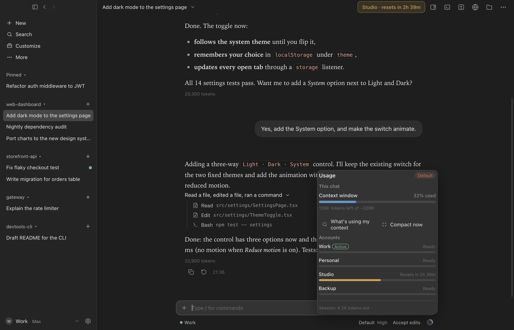 |

| Account switcher | Model per chat |
|:---:|:---:|
| 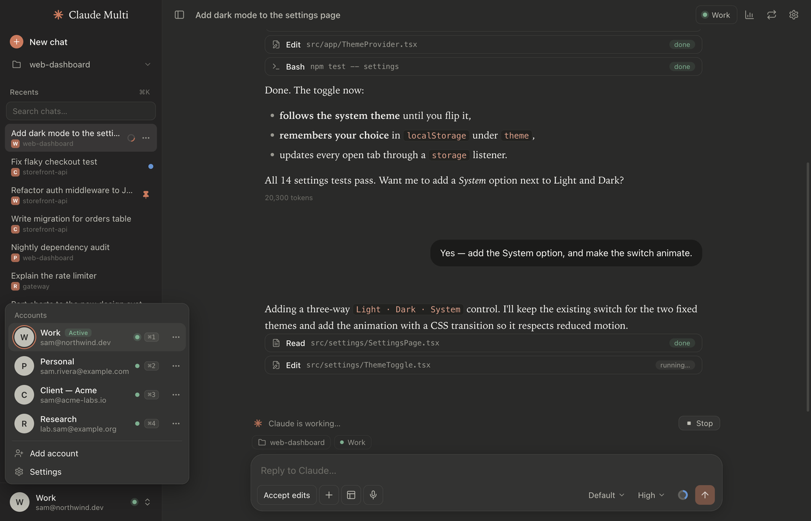 | 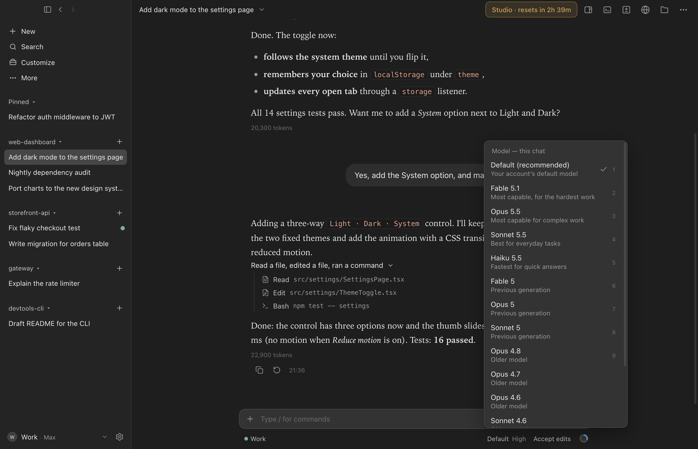 |

| Context inspector | Token savers |
|:---:|:---:|
| 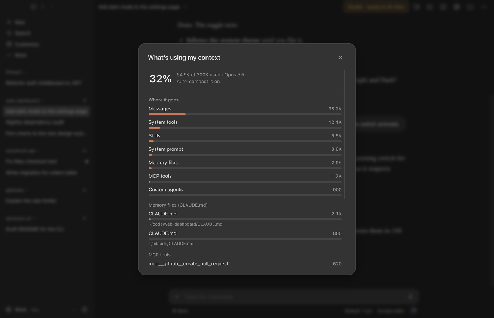 | 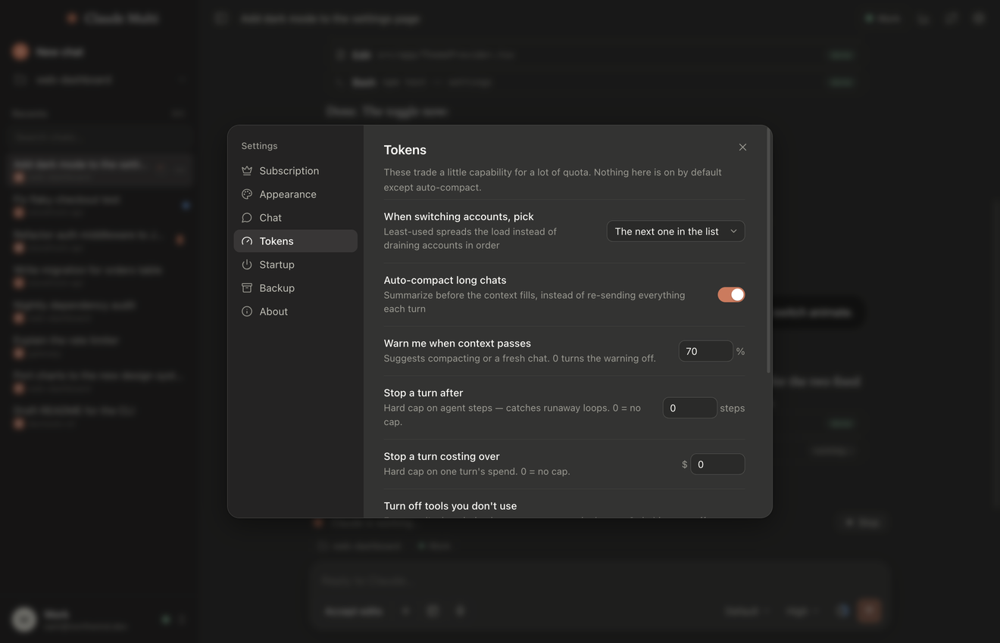 |

| Command palette | Light theme |
|:---:|:---:|
| 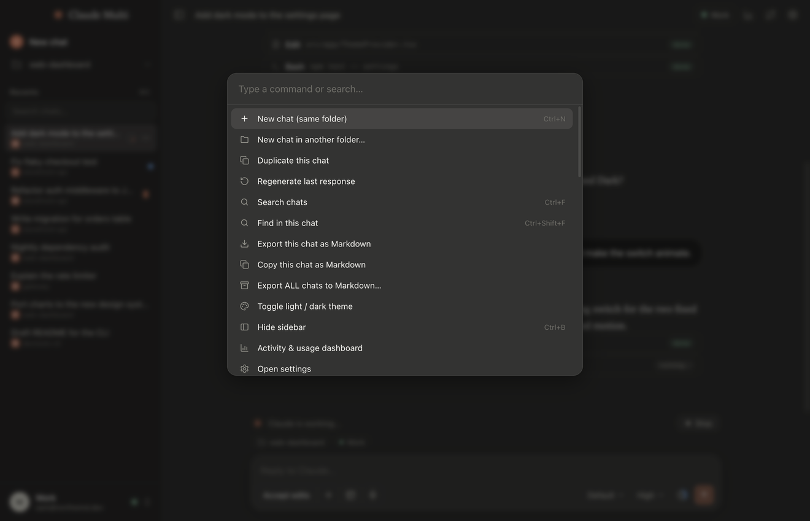 | 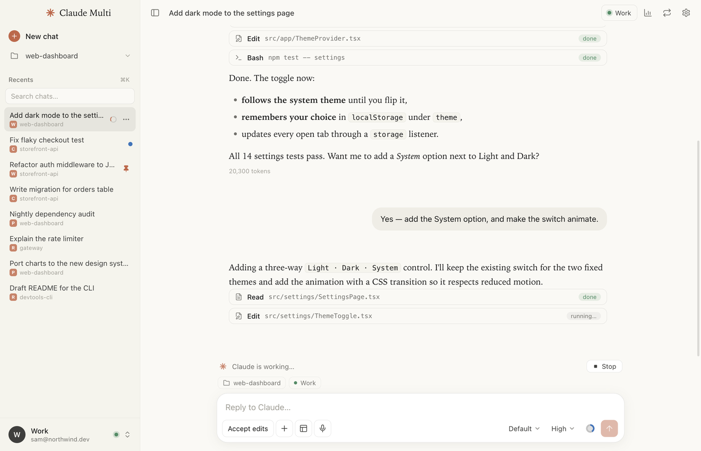 |

Every screenshot is the real app, version 1.36.0, running with demo accounts and projects.

**[See every feature on purffle.com →](https://purffle.com/claude-multi/)**

## Pricing

| Plan | Price | Claude accounts |
|---|---|---|
| **Basic** | $5 / month | Up to 5 |
| **Pro** | $10 / month | Up to 20 |
| **Max** | $20 / month | Unlimited |

Every plan includes every feature and every update, on up to 3 computers. Billing is handled by Gumroad; cancel any
time and your plan stays active until the end of the period you paid for.
**[Compare plans →](https://purffle.com/claude-multi/pricing/)**

## Download

**[Download Claude Multi 1.36.0 from purffle.com →](https://purffle.com/claude-multi/download/)**

The download page picks the right file for your computer:

| Platform | File |
|---|---|
| **Windows 10 and 11** | Installer or portable `.exe` |
| **macOS 11+, Apple Silicon** | `-arm64.dmg` |
| **macOS 11+, Intel** | `.dmg` |
| **Linux, 64-bit** | `.AppImage` |

**You also need:** the [Claude Code CLI](https://claude.com/claude-code). No Node.js install is needed.

## Quick start

1. [Create a Claude Multi account](https://purffle.com/claude-multi/sign_up/) and [pick a plan](https://purffle.com/claude-multi/pricing/).
2. [Download Claude Multi](https://purffle.com/claude-multi/download/), install it and sign in with the same email.
3. Click **Add account** and sign in to each Claude subscription once.
4. Open a project folder and chat. When an account hits its limit, Claude Multi takes over.

## Guides

- [Claude usage limit explained](https://purffle.com/claude-multi/claude-usage-limit.html): how the 5-hour window works and how to keep working when you hit it.
- [How to use multiple Claude accounts](https://purffle.com/claude-multi/multiple-claude-accounts.html): the ways to run several Claude accounts on one computer.

## Account safety and terms

Claude Multi is built for **one person using their own accounts**: not sharing, pooling or reselling access.
Each account signs in with its own normal subscription login and stays within its own quota.

**Important:** since February 2026, Anthropic's terms restrict using Pro/Max subscription credentials in
third-party tools. Claude Multi does exactly that, and account restrictions can happen without warning. Use it at
your own risk, and read [Anthropic's terms](https://www.anthropic.com/legal/consumer-terms) before deciding.
Claude Multi is an independent product, not made or endorsed by Anthropic.

## Privacy

- Your conversations go only between your local `claude` process and Anthropic's servers.
- Claude account logins are written by Claude Code on your computer; Claude Multi never uploads them.
- The app contacts **purffle.com** only to sign you in, check your plan and look for updates.
- No telemetry, no analytics, no crash reporting.

## Support

Email **[support@purffle.com](mailto:support@purffle.com)** for bugs, feature requests, billing and account
questions, or manage your plan on your [account page](https://purffle.com/claude-multi/account/).

## License

Claude Multi is proprietary software. Use requires a Claude Multi account and an active plan; see the
[terms of service](https://purffle.com/claude-multi/terms/) and [LICENSE](LICENSE).
Versions up to and including v1.30.7 were released under the MIT License.

© 2026 Purffle · [purffle.com/claude-multi](https://purffle.com/claude-multi/)
